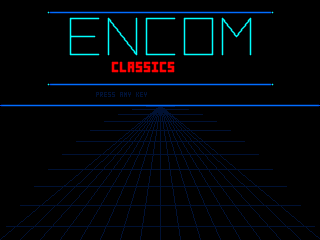
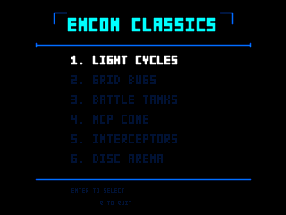
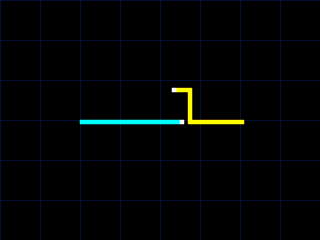
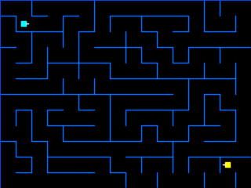
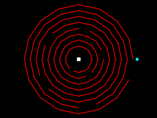
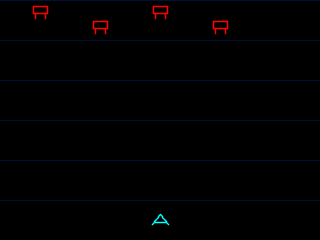
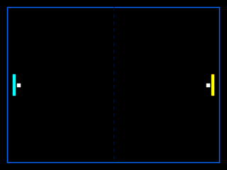

# ENCOM's Hits

Retro arcade game collection in Cyrius. Six games, one engine, neon on black. The art is math.



## The Games

| Game | Mechanic | Lines |
|------|----------|-------|
| **Light Cycles** | Trail walls, last alive wins | 231 |
| **Grid Bugs** | Grid traversal, shortest-path pursuit | 255 |
| **Battle Tanks** | Maze combat, ricochet projectiles | 277 |
| **MCP Cone** | Rotating barriers, timing-based | 315 |
| **Interceptors** | Vertical shooter, wave enemies | 300 |
| **Disc Arena** | 1v1 disc combat, wall ricochets | 292 |



## Build

```sh
cyrius deps                                   # vendor stdlib into lib/ (first build only)
cyrius build src/main.cyr build/encom-hits
./build/encom-hits                            # run from a Linux console
```

Requires Cyrius >= 6.7.18. The game draws straight to `/dev/fb0` and reads the keyboard from the terminal it was started in, so run it from a Linux virtual console (Ctrl+Alt+F3, say) as a user who can write `/dev/fb0` (usually the `video` group). Without a framebuffer it still runs and writes a frame to `/tmp/encom-hits.ppm` about once a second; without a terminal it refuses to start.

## Screenshots and tests

Write the 14 reference screens to `/tmp/encom_*.ppm` (no terminal or framebuffer needed):

```sh
./build/encom-hits --ppm
```

```sh
cyrius test tests                             # unit and regression suites
sh tests/frames.sh build/encom-hits           # all 28 reference frames vs tests/frames.sha256
cyrius bench benches/frame.bcyr               # per-game frame times
```

## Controls

Every game is one player against the computer. WASD and the arrow keys are interchangeable.

| Action | Keys |
|--------|------|
| Move | WASD or arrow keys |
| Fire | Space (also W / Up in MCP Cone and Interceptors) |
| Throw (Disc Arena) | Space, aimed by paddle height; D throws straight |
| Select game | 1-6, or W/S or Up/Down then Enter |
| Back to menu | Escape |
| Quit | Q or Ctrl+C |

## Visual Style

Neon wireframe on black. No textures, no sprites, no assets. Every pixel is a computed line. 320x240 framebuffer, 8-color neon palette, additive glow bloom.







## Architecture

4,284 lines across 18 source files. Shared engine (framebuffer, drawing, input, glow, AI, grid), a front end (font, scores, screens, play loop), and one module per game.

```
src/
  main.cyr          — Entry, --ppm screenshot mode, main loop (220)
  engine.cyr        — Framebuffer, /dev/fb0 + PPM output, frame timing (432)
  draw.cyr          — Bresenham line, hline/vline, rect, pixel (148)
  input.cyr         — Raw mode, escape-sequence parser, terminal restore on signals (349)
  glow.cyr          — Additive neon bloom effect (80)
  text.cyr          — 3x5 bitmap font, A-Z 0-9 and punctuation (135)
  scores.cyr        — High-score file (67)
  screens.cyr       — Splash, menu, title cards, result cards (277)
  play.cyr          — Per-game input and ticks, one frame of play (329)
  ai.cyr            — Maze A*, Light Cycles lookahead (289)
  grid.cyr          — Maze generation (iterative backtracker) (193)
  types.cyr         — Colors, constants, game IDs (95)
  lightcycles.cyr   — Light Cycles (231)
  gridbugs.cyr      — Grid Bugs (255)
  tanks.cyr         — Battle Tanks (277)
  mcpcone.cyr       — MCP Cone (315)
  interceptors.cyr  — Interceptors (300)
  discs.cyr         — Disc Arena (292)
```

## License

GPL-3.0-only

---

*End of line.*
